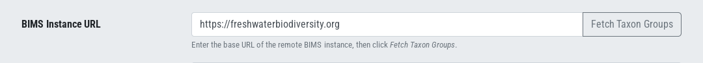
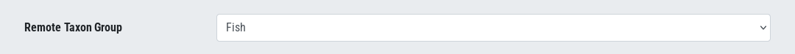
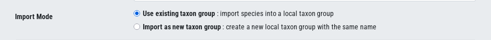
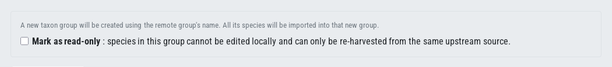
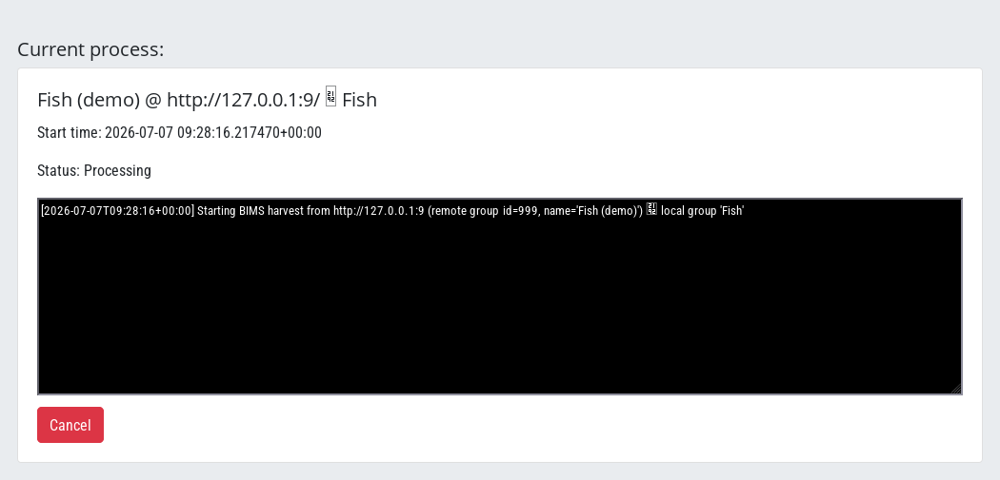
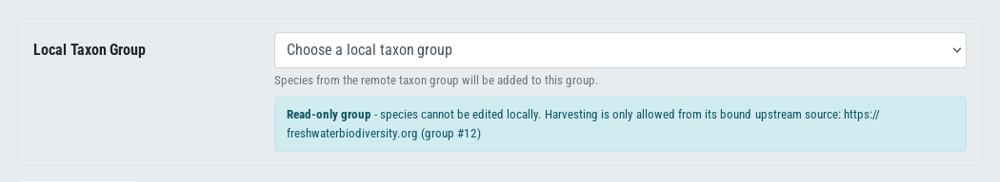
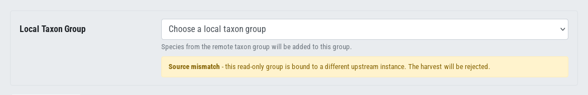
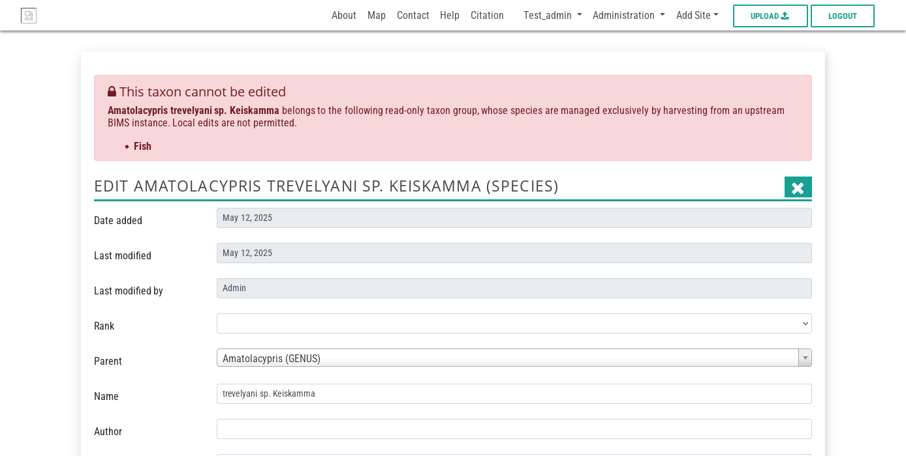
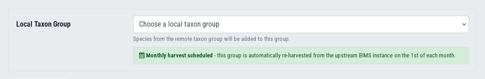
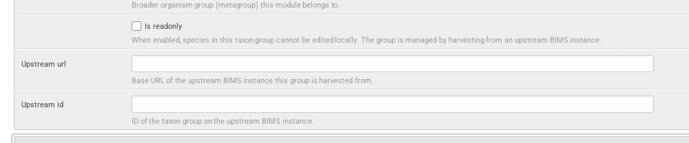

# Sharing Biodiversity Modules Across BIMS Instances (Read-Only)

This section explains how to share biodiversity modules (species taxon groups)
between BIMS instances in **read-only** mode. It is written for site
administrators and taxonomic experts who manage species modules.

---

## Overview

A BIMS instance can import validated species from another **upstream** BIMS
instance and keep them in sync. When a local module is marked **read-only**, its
species are managed exclusively by the upstream instance:

- Species in the module **cannot be edited locally**.
- The module is **bound to a single upstream source** (URL + remote group ID).
- Re-harvesting is only allowed from that same source.
- Ownership and edit restrictions from upstream are preserved.

This lets a network of BIMS sites share a common, authoritative taxonomy while
preventing accidental local changes that would diverge from the source.

**Who can do this?** Access to the harvester requires the
`bims.can_harvest_species` permission. Users without it cannot open the harvest
page or the supporting APIs.

---

## Key concepts

| Term | Meaning |
|---|---|
| **Upstream instance** | The remote BIMS site that acts as the authoritative data source. |
| **Taxon group / module** | A species module (category `SPECIES_MODULE`) that groups taxa. |
| **Read-only group** | A local module whose species are managed by harvesting and cannot be edited locally. |
| **Harvest** | The process of importing/updating species from the upstream instance. |
| **Upstream binding** | The `upstream_url` + `upstream_id` pair that ties a read-only group to one remote source. |

---

## Step-by-step: sharing a module in read-only mode

Open the harvester from the admin menu (**Harvest BIMS Species**, at
`/harvest-bims/`).

### Step 1 - Enter the upstream BIMS URL

Type the base URL of the upstream instance (for example
`https://freshwaterbiodiversity.org`) and click **Fetch Taxon Groups**. BIMS
contacts the remote instance and lists the species modules available there.

### Step 2 - Select the remote taxon group

Choose the module you want to share from the dropdown. This is the module on the
**upstream** instance whose species will be imported.

### Step 3 - Choose the import mode

- **Use existing taxon group** - import the remote species into a local module
  you already have.
- **Import as new taxon group** - create a new local module using the remote
  group's name. This is the usual choice when setting up a shared module for the
  first time.

### Step 4 - Mark the module as read-only

When importing as a new taxon group, tick **Mark as read-only**. This binds the
new module to the upstream source and prevents local editing of its species.

> If you selected **Use existing taxon group** and that group is already
> read-only, BIMS shows an information banner confirming the upstream source the
> group is bound to (see [Read-only indicators](#read-only-indicators-in-the-ui)).

### Step 5 - Start harvesting

Click **Start harvesting**. A live progress panel shows the harvest log and a
running status. You can click **Cancel** at any time to stop.

When the harvest finishes, the new module and its validated species are
available locally, in read-only mode.

---

## Read-only indicators in the UI

Read-only modules are clearly marked throughout the interface.

**In the local taxon group dropdown**, read-only groups show a `[read-only]`
label next to their name. When you select one, an information banner appears
naming the upstream source it is bound to:

**Source mismatch warning.** If you try to harvest a read-only group from a
different upstream URL or group ID than the one it is bound to, BIMS warns you
before you start and the harvest will be rejected:

---

## What read-only means for editing

Species that belong to a read-only module cannot be edited locally. If a user
opens the taxon edit page for such a species, BIMS returns an HTTP 403 and shows
an explanatory banner instead of the edit form. This applies to **every** user,
including superusers and taxon-group experts, and blocks both viewing the edit
form and saving changes.

Because the block is based on the species' membership in *any* read-only group,
a species shared into a read-only module stays protected even if it is also part
of a normal local group.

---

## Keeping shared modules in sync

### Automatic monthly re-harvest

When a module is bound to an upstream source, BIMS schedules an automatic
re-harvest on the **1st of each month**. The UI confirms this with a schedule
notice:

### How updates are applied

On each re-harvest BIMS only touches what actually changed:

- Each remote species is fingerprinted (a checksum of its canonical fields). If
  the fingerprint is unchanged since the last harvest, the species is **skipped**
  and no writes happen. This keeps routine re-harvests fast.
- For read-only groups, the **upstream instance is the source of truth**. When a
  field differs, the upstream value wins and the change is recorded in the
  harvest log. For normal (non-read-only) groups, local values are preserved and
  the upstream only adds new information.
- Tags are always **additive** - existing local tags are never removed.

### Ownership and edit restrictions

Read-only mode preserves the intent of the upstream instance: local users cannot
alter shared species, so the upstream owner's data stays authoritative. Only
validated taxa are imported, so unreviewed upstream records do not leak into the
shared module.

---

## Managing bindings in the Django admin

Administrators can inspect or adjust a module's read-only binding directly on the
**TaxonGroup** record in the Django admin. The relevant fields are:

| Field | Purpose |
|---|---|
| `is_readonly` | Blocks local editing of the module's species when enabled. |
| `upstream_url` | Base URL of the upstream BIMS instance. |
| `upstream_id` | ID of the corresponding taxon group on the upstream instance. |

Setting `is_readonly` here (together with `upstream_url` and `upstream_id`) is an
alternative to the **Mark as read-only** checkbox in the harvester, useful for
retrofitting an existing module.

---

## Troubleshooting

| Symptom | Likely cause | What to do |
|---|---|---|
| "Source mismatch" warning before harvesting | The read-only group is bound to a different upstream URL/ID than the one entered. | Harvest from the bound source, or update the binding in the admin if the upstream moved. |
| Harvest aborts with "upstream source mismatch for read-only group" | Same as above, detected server-side. | Confirm `upstream_url`/`upstream_id` match the source you are harvesting from. |
| Cannot edit a species (403) | The species belongs to a read-only module. | This is expected. Edit it on the upstream instance; changes flow down on the next harvest. |
| Species missing after harvest | Only validated taxa are imported. | Validate the taxon on the upstream instance, then re-harvest. |
| Harvest page not accessible | Missing `bims.can_harvest_species` permission. | Ask an administrator to grant the permission. |

