# Live Layers for GIS (OGC API - Features)

A **live layer** publishes the filter you have applied in BIMS as a URL. You paste that URL into a GIS client such as ArcGIS Pro, ArcGIS Online or QGIS, and the client reads the matching occurrence records directly from BIMS. There is no export and no re-import: when records change in BIMS, the layer shows the change the next time the GIS client refreshes.

Behind the URL, BIMS serves the filter as an [OGC API - Features](https://ogcapi.ogc.org/features/) collection. Any client that supports that standard can use it.

## Overview of the workflow

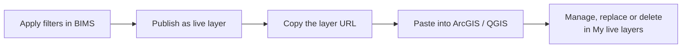

1. A staff user applies filters in BIMS and clicks **Publish as live layer**.
2. BIMS checks the filter, shows how many records match, and creates the layer.
3. The user copies the layer URL and adds it to the GIS client.
4. The user can later replace the URL or delete the layer.

## Before you start

| Requirement | Details |
| -- | -- |
| Live layers switched on | In the BIMS admin, open **Site Settings** (`SiteSetting`) and tick **Enable ogc api**. Without it, the button and the *Live Layers* tab do not appear. 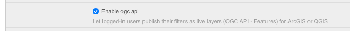 |
| Staff account | Only logged-in **staff** users see **Publish as live layer**. |
| A narrowing filter | At least one filter must be applied (see [What can be published](#what-can-be-published)). |
| At most 100,000 records | The filter may match up to 100,000 records. |

## Step 1: Apply your filters

Apply the filters you want in the BIMS map page (taxon group, area, year range, reference, and so on). See [Filtering](../../user/guide/filtering.md) for the available filters.

You can publish from two places:

* the **site dashboard** opened from the map page, and
* the **Summary Dashboard** (spatial dashboard), which is shown in the screenshots below.

In both, the **Publish as live layer** button sits under the *Distribution* map.

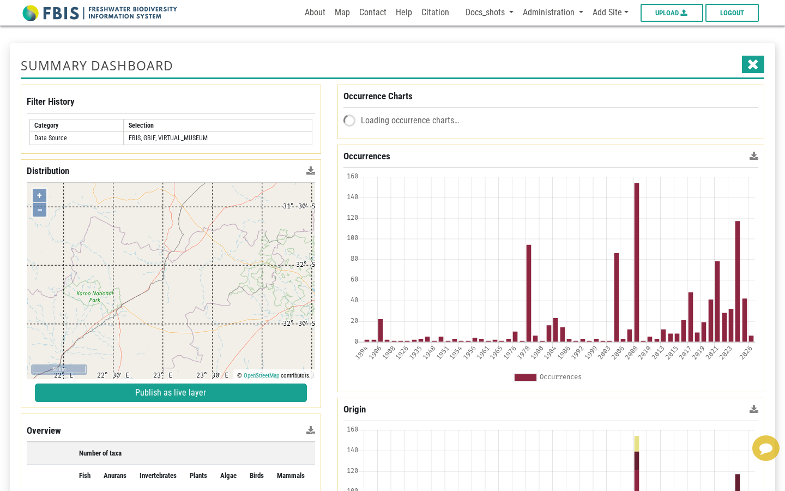

## Step 2: Check the filter

Click **Publish as live layer**. The *Live layer* dialog opens and immediately checks your filter. When the filter is valid, a green message shows how many records match.

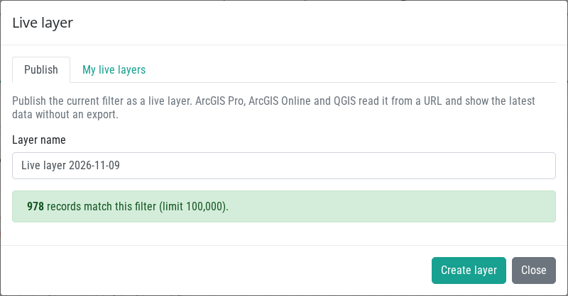

The layer name is pre-filled with `Live layer <date>`. Replace it with a name that helps you recognise the layer later.

If you have the rights to see sensitive or private data, two extra checkboxes appear: **Include sensitive data** and **Include private data**. Both are off by default. If you tick either one, a warning reminds you that anyone with the URL can read that data.

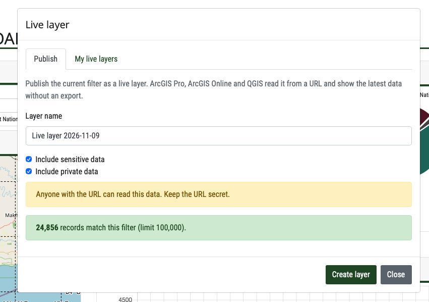

### When the filter cannot be published

The **Create layer** button stays disabled and a red message explains why.

**No filter applied.** Apply at least one narrowing filter and try again.

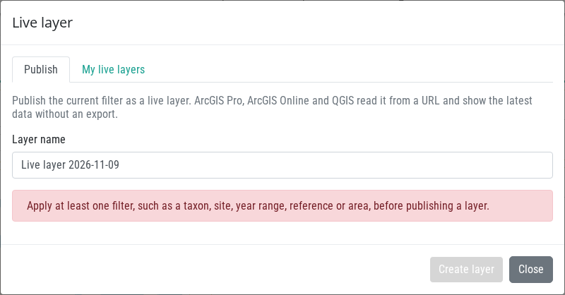

**More than 100,000 records match.** BIMS holds millions of records, so a layer is capped. Narrow the filter (for example by taxon group, area or years) and try again.

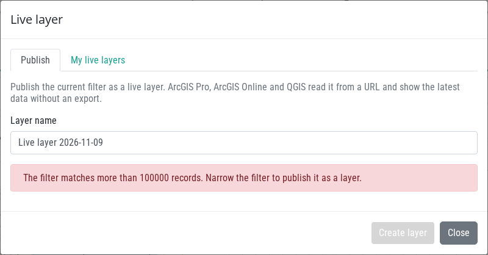

Other messages you may see: the filter type is not supported as a live layer, you are not allowed to include the chosen data, the server is busy (try again in a moment), or live layers are switched off on this server.

## Step 3: Create the layer and copy the URL

Click **Create layer**. The dialog shows the layer URL, how many records it holds, and short instructions for ArcGIS Pro, ArcGIS Online and QGIS. BIMS also copies the URL to your clipboard.

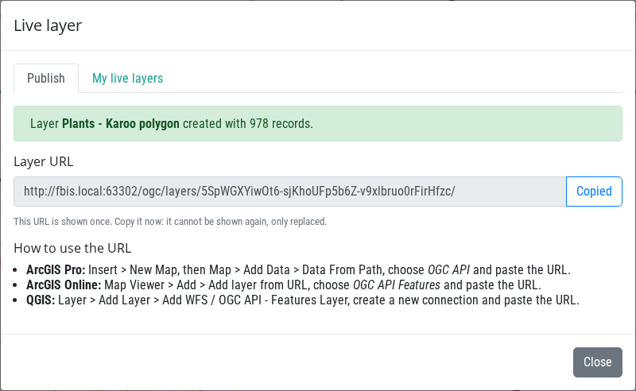

!!! warning "The URL is shown only once"
    BIMS stores only a hash of the secret part of the URL, so it **cannot show the URL again**. Copy it now. If you lose it, use **New URL** in *My live layers* to get a replacement.

!!! warning "Treat the URL as a password"
    Anyone with the URL can read the layer, without logging in. Share it only with people who should see the data, and be extra careful when you include sensitive or private data.

## Step 4: Use the URL in a GIS client

Paste the URL ending in `/ogc/layers/<token>/` into the client.

* **ArcGIS Pro:** *Insert > New Map*, then *Map > Add Data > Data From Path*, choose **OGC API** and paste the URL.
* **ArcGIS Online:** *Map Viewer > Add > Add layer from URL*, choose **OGC API Features** and paste the URL.
* **QGIS:** *Layer > Add Layer > Add WFS / OGC API - Features Layer*, create a new connection and paste the URL.

Below, a live layer is shown in QGIS.

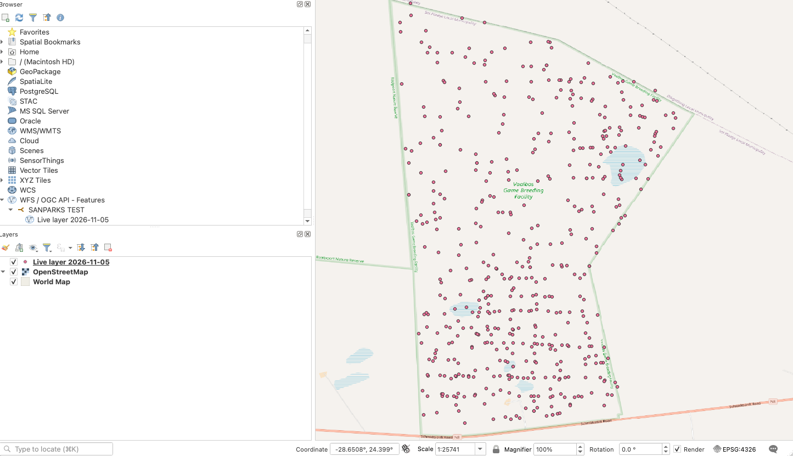

The client pages through the records on its own. Each GIS client decides when to refresh, so a change in BIMS may need a manual refresh (or reopening the project) before it shows. Responses can also be reused by clients for up to 60 seconds.

Each record is a point feature at the site location, with attributes such as the site code, sampling date, taxonomy, origin, conservation status, owner, source reference and the spatial context of the site.

## Step 5: Manage your layers

Open the **My live layers** tab of the dialog, or go to your profile page and open the **Live Layers** tab.

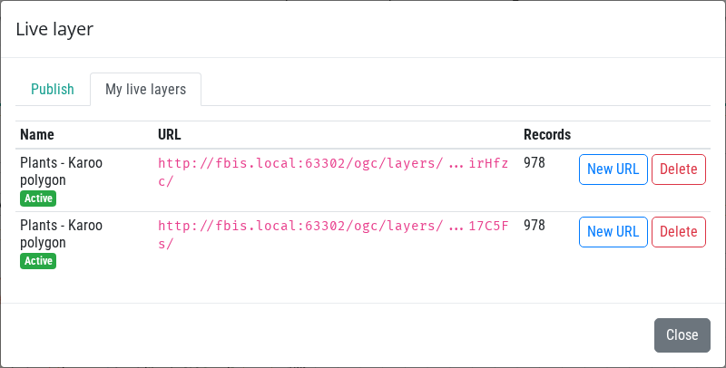

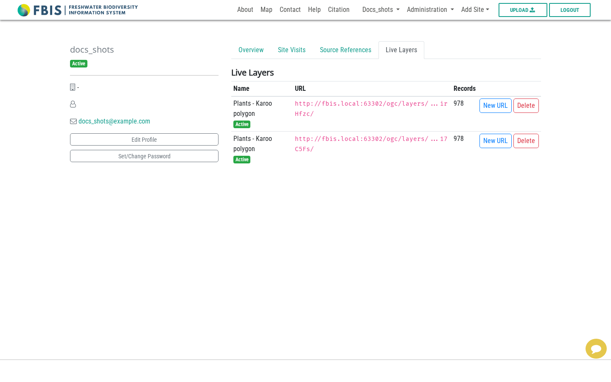

The list shows each layer's name, status (**Active** or **Revoked**), a masked URL and its record count.

| Action | What it does |
| -- | -- |
| **New URL** | Creates a replacement URL. The **old URL stops working at once**. The new URL is shown once, so copy it. Use this if a URL was shared by mistake or lost. |
| **Delete** | Removes the layer. Its URL stops working for good. |

Both actions ask for confirmation first.

## What can be published

* A filter must contain at least one narrowing filter: search text, taxon, site, months, invasions, category, collector, reference, reference category, conservation status, decision support tool, boundary, endemism, source collection, tags, dataset, polygon, modules, meta group, ecosystem type or spatial filter, or a year range with both a start and an end year.
* Only occurrence (biological collection) records are served. Water temperature, physico-chemistry and climate searches cannot be published.
* The layer is evaluated **as its owner**, with the same visibility rules as in BIMS (embargo, sensitive, private and validation rules). If the owner's access changes, the layer changes too.
* The layer stores the *filter*, not a copy of the data, so new records that match the filter appear automatically.

## For developers

The endpoints, response format, settings and server limits are described in [Live Layers (OGC API - Features)](../../developer/guide/ogc-live-layers.md) in the Developers guide.

## Troubleshooting

| Problem | What to check |
| -- | -- |
| No **Publish as live layer** button | You must be logged in as staff and **Enable ogc api** must be ticked in Site Settings. |
| **Create layer** is disabled | Read the red message: no filter, too many records, or an unsupported filter. |
| Layer shows old data in the GIS client | Refresh the layer in the client. Clients may reuse responses for up to 60 seconds. |
| The GIS client cannot connect | Check that the URL was copied completely, that the layer was not deleted or replaced with **New URL**, and that the layer is still **Active**. |
| Client reports 429 or 503 | Wait a moment and refresh. Avoid reloading a large layer repeatedly. |
