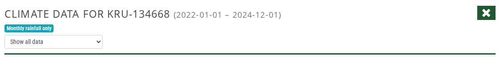
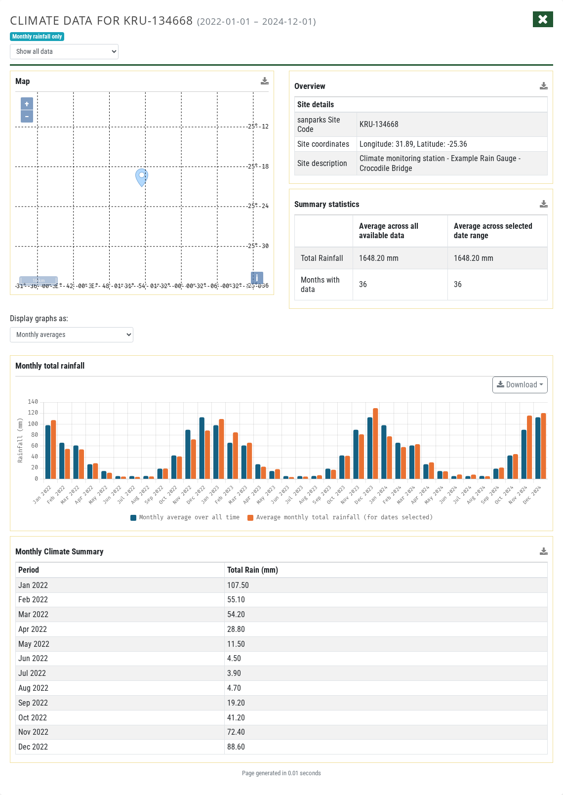
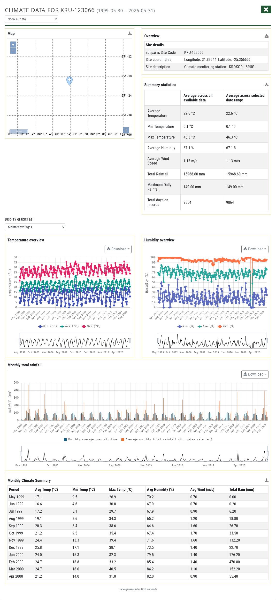
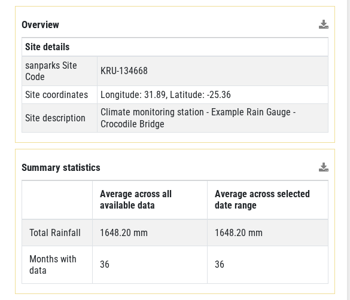
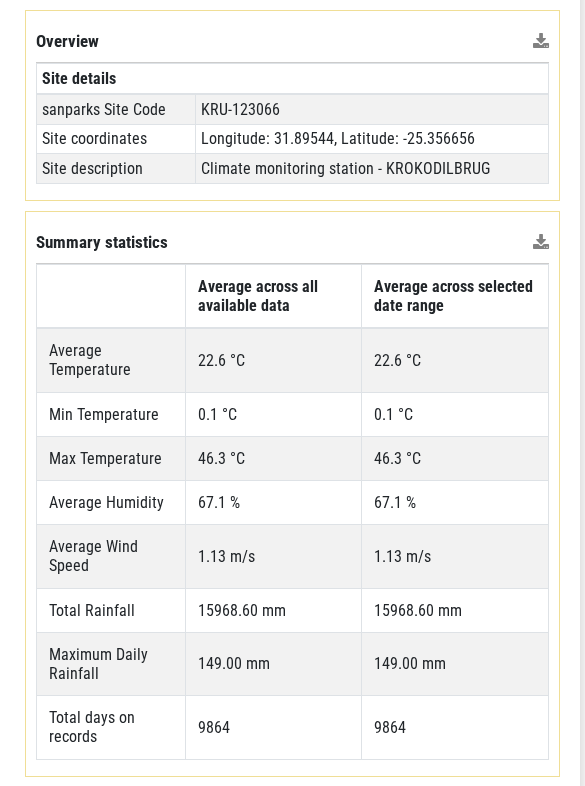
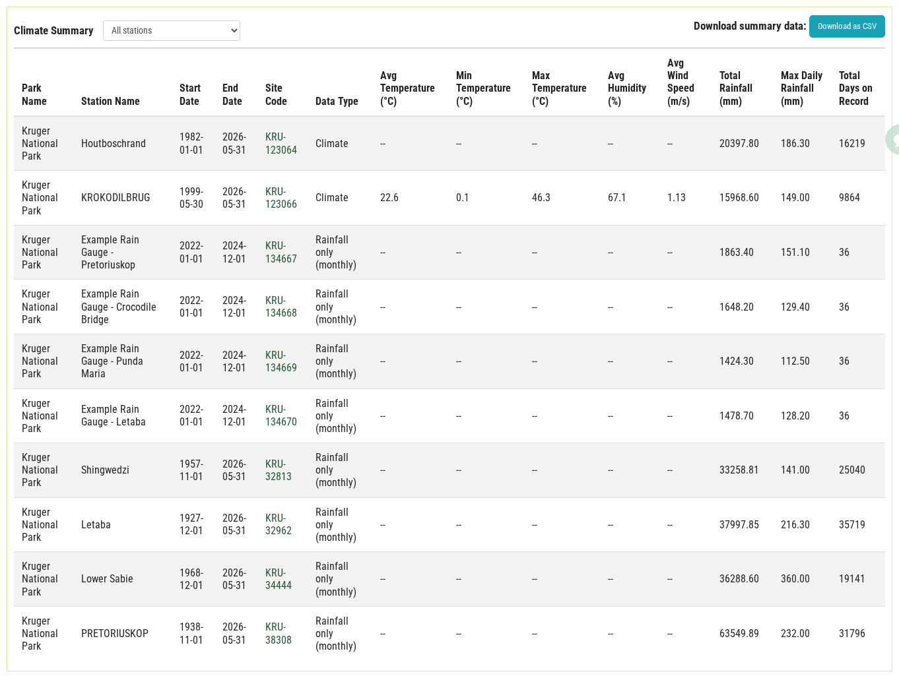
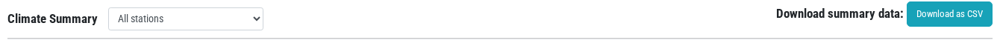
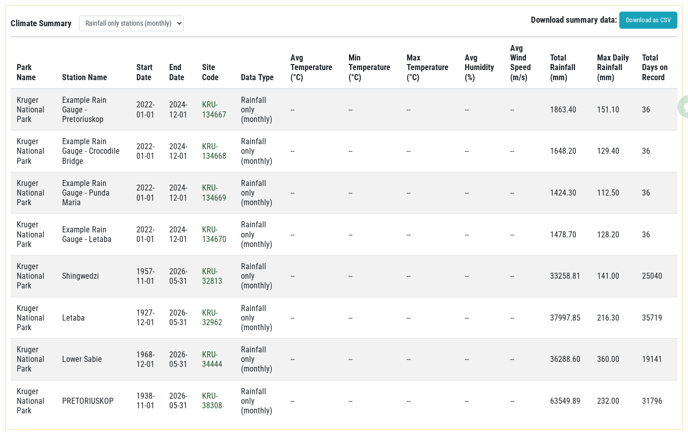

# Climate dashboard: monthly rainfall-only stations

Most climate stations record temperature, humidity, wind and rainfall every day. Some stations, usually rain gauges, record only rainfall, often as one total per month. The climate dashboards recognise these **rainfall-only stations**. They show only the rainfall information for them and label them so you can tell them apart from full climate stations.

## How a station is identified as rainfall-only

BIMS works out the station type from the station's data. You don't need to set anything.

| Station type | When it applies | Label shown |
|---|---|---|
| Rainfall only | The station has rainfall values, but no temperature, humidity or wind values | *Monthly rainfall only* (single-site) / *Rainfall only (monthly)* (multi-site) |
| Climate | Every other station | *Climate* |

Notes:

- The missing-data placeholder `-999` is not counted as a value. A station whose temperature column holds only `-999` is still rainfall-only.
- The type is based on **all** of the station's records, not only the period you are viewing. Choosing a year with no temperature data does not turn a climate station into a rainfall-only station.

## Single-site climate dashboard

Open the dashboard by clicking a climate station on the map and choosing the climate dashboard.

### Monthly rainfall only badge

A *Monthly rainfall only* badge appears under the title of a rainfall-only station.



### Dashboard layout

The dashboard for a rainfall-only station shows only rainfall information:



For comparison, this is the dashboard for a full climate station:



The differences are:

| Section | Climate station | Rainfall-only station |
|---|---|---|
| Badge | None | *Monthly rainfall only* |
| Summary statistics | Temperature, humidity, wind speed, total rainfall, maximum daily rainfall and total days on record | Total rainfall and **Months with data** |
| *Display graphs as* | Daily, monthly or annual averages | Monthly or annual averages only |
| Temperature and humidity charts | Shown | Hidden |
| Monthly total rainfall chart | Shown | Shown |
| Monthly Climate Summary table | All columns | *Period* and *Total Rain (mm)* only |
| Daily raw data download | Shown to users with access | Hidden, because there is no daily data |

### Summary statistics

On a rainfall-only station (left), the summary statistics panel shows the total rainfall and the number of months with data. A full climate station (right) also shows temperature, humidity and wind statistics.

| Rainfall-only station | Climate station |
|---|---|
|  |  |

## Multi-site climate dashboard

Search or filter on the map, open the multiple sites panel and choose the climate dashboard.

### Data Type column

The *Climate Summary* table has a **Data Type** column. Each station is shown as *Climate* or *Rainfall only (monthly)*.



### Filtering by station type

Use the drop-down next to the *Climate Summary* title to choose which stations the table shows:

- **All stations** (default)
- **Climate stations**
- **Rainfall only stations (monthly)**



This is the table filtered to rainfall-only stations:



**Download as CSV** exports only the stations the filter shows, and the CSV includes the *Data Type* column.

## Uploading monthly rainfall data

Monthly rainfall uses the normal climate data upload. The file can be CSV or Excel.

[:material-download: Download the monthly rainfall CSV template](files/monthly-rainfall-template.csv){ .md-button download }

```csv
Station,Latitude,Longitude,Year,Month,Day,Daily rainfall
Example Rain Gauge,-25.36,31.89,2024,1,1,107.5
Example Rain Gauge,-25.36,31.89,2024,2,1,55.1
Example Rain Gauge,-25.36,31.89,2024,3,1,54.2
```

| Column | Required | Description |
|---|---|---|
| `Station` | Yes | Station name. Rows with the same name are added to the same station, which is created if it doesn't exist yet. |
| `Latitude` | Yes | Decimal degrees, for example `-25.36`. |
| `Longitude` | Yes | Decimal degrees, for example `31.89`. |
| `Year` | Yes | Year of the record, for example `2024`. |
| `Month` | Yes | Month number, `1` to `12`. |
| `Day` | Yes | Use `1`, so each monthly total is recorded on the first day of the month. |
| `Daily rainfall` | Yes | The **monthly total** rainfall in mm. The column keeps this name because the same upload is used for daily data. Use `-999` if the value is missing. |

Use one row per station per month. Uploading a row again for the same station and date replaces the old value.

Leave out the temperature, humidity and wind columns, or leave them empty or set to `-999`. If any of them has a real value, the station is shown as a full climate station instead of a rainfall-only one.

After the upload, the dashboards show the station as rainfall-only.

## Known limitations

- Stations are classified only by **which** measurements they have, not by how often they record. A station that records rainfall daily but has no other measurements is also labelled *Monthly rainfall only*. Its dashboard then hides the daily view, and *Months with data* actually counts days.
- In the multi-site table, rainfall-only stations still show *Max Daily Rainfall* and *Total Days on Record*. For a monthly station these are the largest monthly total and the number of months.
