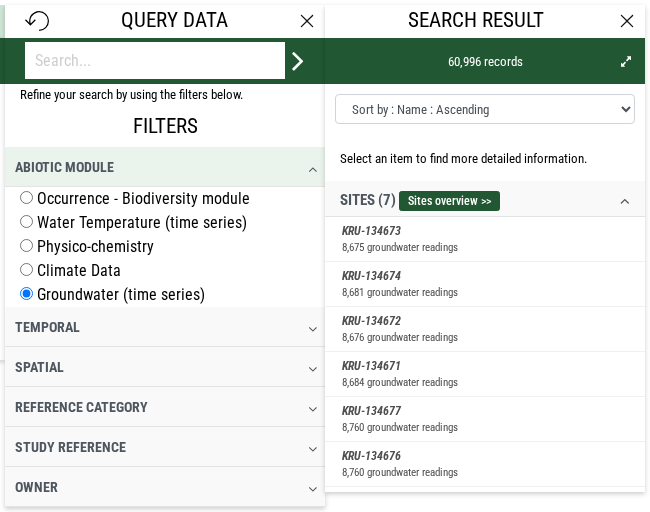
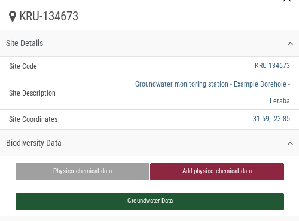
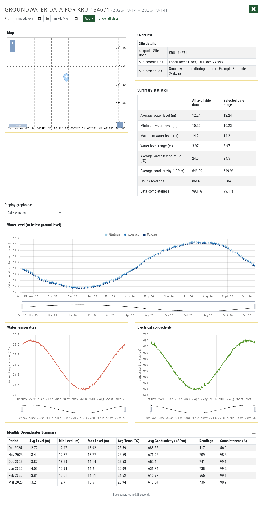
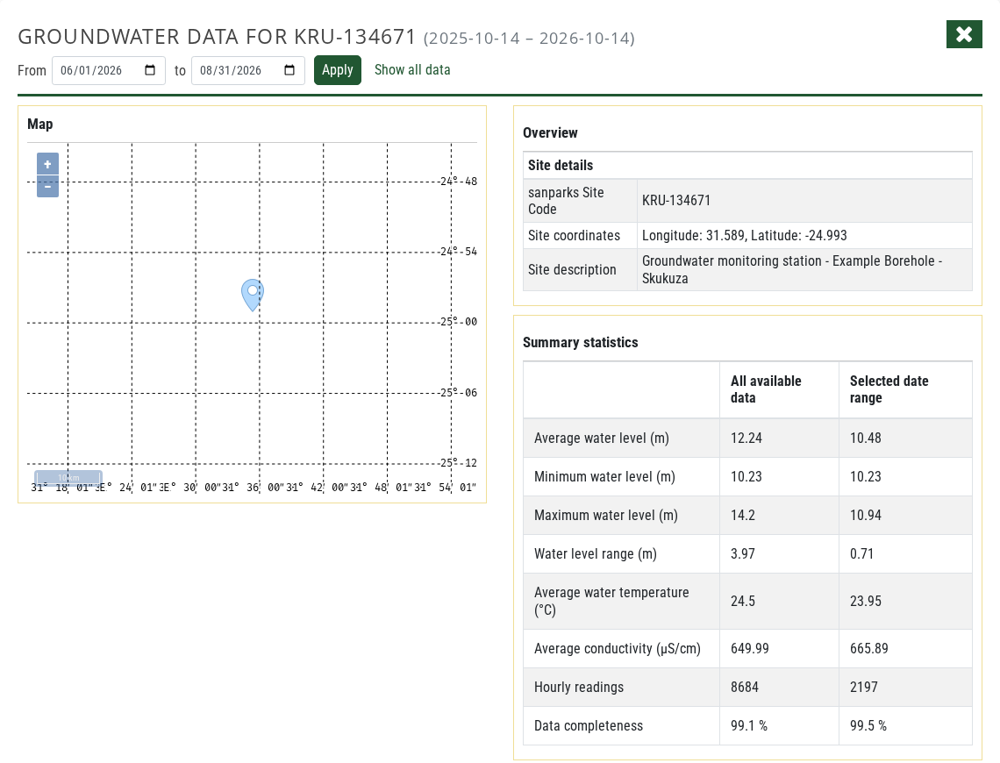
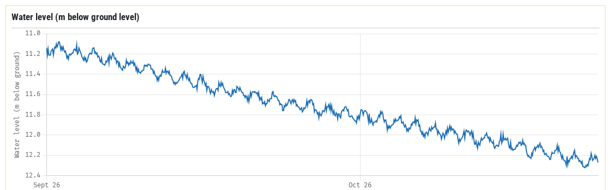
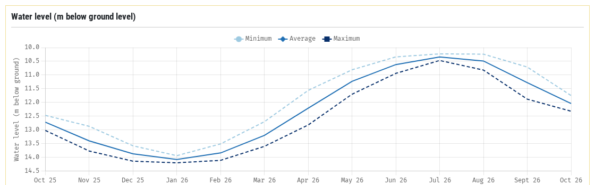
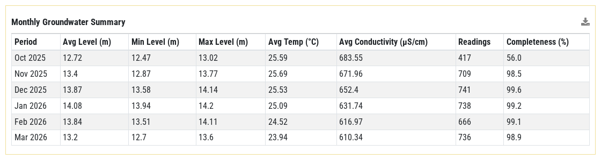
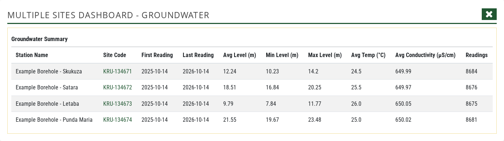
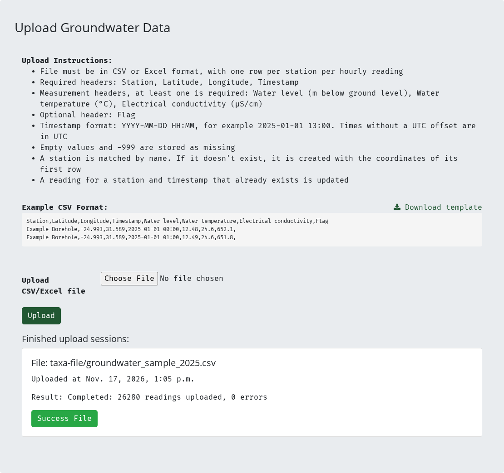

# Groundwater dashboard

The groundwater dashboard shows **hourly** readings from groundwater monitoring stations (boreholes) as summary statistics, charts and monthly tables. It is laid out like the climate dashboard. Each station can record three parameters:

| Parameter | Unit | Notes |
|---|---|---|
| Water level | m below ground level | Depth to the water. A **larger** number means the water is **deeper**. |
| Water temperature | °C | Optional |
| Electrical conductivity | µS/cm | Optional. An indicator of salinity. |

There are two dashboards:

- a **single-site dashboard**, with the full detail for one station;
- a **multi-site dashboard**, with a summary row for every station that has groundwater data.

## Finding groundwater stations on the map

1. Open the map and click the search icon to open **Query Data**.
2. Under **Filters**, open **Abiotic Module** and choose **Groundwater (time series)**.

The search results then list only the stations with groundwater readings, with the number of readings for each. The temporal, spatial and search box filters still apply. For example, choosing a year lists only the stations with readings in that year.



Click a station in the results to open its site panel, then click **Groundwater Data** to open its dashboard. From the panel for several sites, the button opens the multi-site dashboard.



While the groundwater filter is selected, the **Sites overview** and the spatial dashboard only count the biodiversity records of groundwater stations.

## Opening the dashboards

| Dashboard | Address |
|---|---|
| Multi-site | `/groundwater/dashboard-multi-sites/` |
| Single-site | `/groundwater/<site id>/`, the **Groundwater Data** button on the map, or a **Site Code** in the multi-site dashboard |

The single-site dashboard only opens for stations that have groundwater readings. Other sites return a *page not found* error.

The **X** at the top right of a dashboard returns to the page you opened it from. If you came from the map, the map opens again with the same search and view. If the dashboard was opened directly, for example from a link in a new tab, the X opens the map.

## Single-site groundwater dashboard



The dashboard has these sections, from top to bottom:

1. **Title.** The station's site code, followed by the dates of its first and last readings.
2. **Date range filter.** Limits the statistics, charts and table to a period (see below).
3. **Map.** The location of the station.
4. **Overview.** The site code, coordinates and description. Users who are allowed to edit the station can change the description with the pencil icon.
5. **Summary statistics.** The statistics for all of the station's data and for the selected date range, side by side.
6. **Charts.** Water level, water temperature and electrical conductivity.
7. **Monthly Groundwater Summary.** One row per month.

### Choosing a date range

Choose a **From** and **to** date and click **Apply**. **Show all data** removes the filter. The *Selected date range* column, the charts and the monthly table then cover only that period. The *All available data* column always covers every reading of the station, so you can compare the period with the station's full record.



### Summary statistics

| Statistic | Meaning |
|---|---|
| Average / Minimum / Maximum water level (m) | Calculated from the hourly readings, in metres below ground level |
| Water level range (m) | Maximum water level minus minimum water level |
| Average water temperature (°C) | Shown only if the station records temperature |
| Average conductivity (µS/cm) | Shown only if the station records conductivity |
| Hourly readings | Number of readings |
| Data completeness | Readings as a percentage of the hours between the first and last reading |

**Data completeness** tells you how much of the record is missing. One reading every hour gives 100 %. Gaps, such as a logger that stopped for a week, lower the percentage.

### Charts

Use **Display graphs as** to choose how the readings are grouped:

| Option | What is plotted |
|---|---|
| Hourly (last 31 days) | Every reading in the last 31 days of the selected range |
| Daily averages | One point per day (default) |
| Monthly averages | One point per month |
| Annual averages | One point per year |

The hourly view only shows the last 31 days because a full year has more than 8,000 points.

The **water level** chart shows the minimum, average and maximum for each period. Its vertical axis is **reversed**: deeper water is lower on the chart, so a falling line means the water table is dropping.

Hourly view:



Monthly averages:



The **water temperature** and **electrical conductivity** charts appear only when the station records those parameters. They show the average for each period.

Move the pointer over a chart to see the values for a period. In the default daily view, drag the handles of the small chart below the main chart to zoom in on part of the record.

### Monthly Groundwater Summary



Each row covers one month. It shows:

- the average, minimum and maximum water level;
- the average water temperature and conductivity;
- the number of readings;
- the **completeness**, which is the number of readings as a percentage of the hours in the month.

The first and last months are often incomplete because the record starts or ends partway through the month. In the example above, October 2025 is 56 % complete for that reason.

Downloads:

- The **download icon** saves the monthly table as a CSV file.
- **Hourly CSV**, shown only to users in the private data group, downloads every hourly reading in the selected date range. The file includes the timestamp, the three parameters and the data flag.

## Multi-site groundwater dashboard



The *Groundwater Summary* table lists every station with groundwater data and shows:

- the first and last reading dates;
- the average, minimum and maximum water level;
- the average temperature and conductivity;
- the number of readings.

Click a **Site Code** to open that station's single-site dashboard.

The multi-site dashboard always lists **all** groundwater stations. Map search and filters do not apply to it.

## Uploading groundwater data

Users who can upload data can add groundwater readings from a CSV or Excel file. Click your name at the top right and choose **Groundwater Data** under *Upload*, or go to `/groundwater/upload/`.



[:material-download: Download the groundwater CSV template](files/groundwater-upload-template.csv){ .md-button download }

```csv
Station,Latitude,Longitude,Timestamp,Water level,Water temperature,Electrical conductivity,Flag
Example Borehole,-24.993,31.589,2025-01-01 00:00,12.48,24.6,652.1,
Example Borehole,-24.993,31.589,2025-01-01 01:00,12.49,24.6,651.8,
Example Borehole,-24.993,31.589,2025-01-01 02:00,12.49,-999,651.5,Temperature sensor fault
```

Use one row per station per reading.

| Column | Required | Description |
|---|---|---|
| `Station` | Yes | Station name. Rows with the same name are added to the same station. |
| `Latitude` | Yes | Decimal degrees, for example `-24.993`. |
| `Longitude` | Yes | Decimal degrees, for example `31.589`. |
| `Timestamp` | Yes | Date and time of the reading, `YYYY-MM-DD HH:MM`, for example `2025-01-01 13:00`. Times without a UTC offset are in the site's time zone, which the upload page shows. |
| `Water level` | At least one of the three measurements | m below ground level |
| `Water temperature` | At least one of the three measurements | °C |
| `Electrical conductivity` | At least one of the three measurements | µS/cm |
| `Flag` | No | A note about the reading, up to 100 characters, for example a sensor fault. |

The measurement columns can also be named as in the dashboard's hourly CSV download, for example `Water level (m below ground)`.

How the upload works:

- **Missing values.** An empty cell or `-999` is stored as a missing value. A row with no measurement values at all is rejected.
- **Stations.** A station is matched by name; capitals don't matter. If no site has that name, a new station is created with the coordinates of its first row and a generated site code. The coordinates of an existing site are not changed.
- **Uploading again.** A reading for a station and timestamp that already exists is replaced, so you can upload a corrected file again. If the same station and timestamp appear twice in one file, the later row is used.
- **Results.** When the upload finishes, download the **Success File** to see the readings that were saved, and the **Error File** to see the rows that were rejected and why. Typical reasons are an invalid timestamp, a value that is not a number, or coordinates out of range.
- **Missing columns.** If a required column is missing, or there is no measurement column, nothing is uploaded and the page shows which columns are missing.
